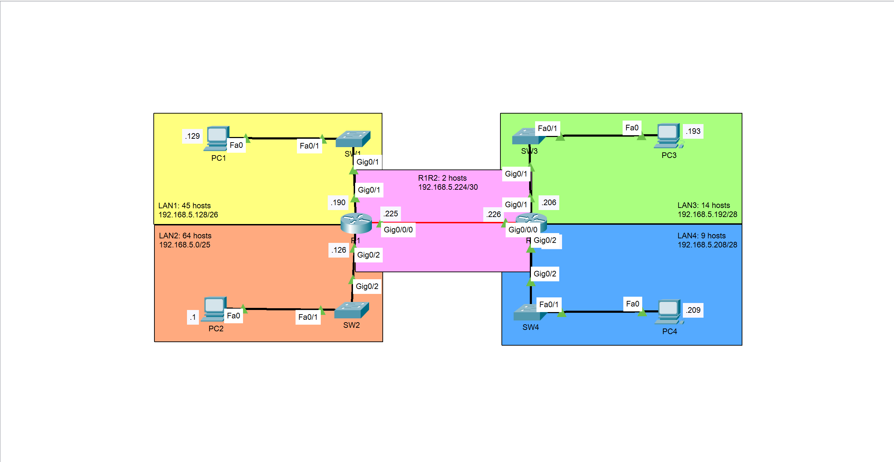

# VLSM and Static Routing

A Cisco Packet Tracer lab demonstrating efficient IPv4 address allocation with Variable Length Subnet Masking (VLSM) and static routing between multiple LANs.

## Overview

This lab simulates a small routed network consisting of two Cisco routers interconnected through a point-to-point link. Each router connects two LANs, allowing four separate networks to communicate through manually configured static routes.

The addressing plan uses the `192.168.5.0/24` network and VLSM to allocate subnet sizes according to host requirements.

## Network Topology



The topology includes:

- 2 Cisco routers (R1 and R2)
- 4 Cisco Catalyst 2960 switches
- 4 PCs distributed across 4 LANs
- 1 point-to-point link between R1 and R2

## Objectives

- Apply VLSM to an IPv4 address block.
- Calculate subnet masks, network addresses, usable host ranges and broadcast addresses.
- Configure router interfaces and end-device IP addressing.
- Establish a point-to-point connection between routers.
- Configure static routes using next-hop addresses.
- Inspect routing tables and interface status.
- Verify connectivity between devices on different LANs.

## Addressing Plan

| Network | Network Address | Prefix | Host Capacity |
|---|---|---:|---:|
| LAN 1 | `192.168.5.128` | `/26` | 62 usable |
| LAN 2 | `192.168.5.0` | `/25` | 126 usable |
| LAN 3 | `192.168.5.192` | `/28` | 14 usable |
| LAN 4 | `192.168.5.208` | `/28` | 14 usable |
| R1–R2 | `192.168.5.224` | `/30` | 2 usable |

## Routing Design

R1 serves LAN 1 and LAN 2, while R2 serves LAN 3 and LAN 4. Each router uses static routes to reach the remote LANs through the other router's point-to-point IP address.

| Router | Next hop | Remote networks |
|---|---|---|
| R1 | `192.168.5.226` | `192.168.5.192/28`, `192.168.5.208/28` |
| R2 | `192.168.5.225` | `192.168.5.0/25`, `192.168.5.128/26` |

## Verification

The lab includes evidence of router interface status and routing-table entries.

Useful Cisco IOS commands:

```text
show ip interface brief
show ip route
ping <destination-ip>
```

The routing tables confirm directly connected networks and static routes to remote LANs. End-to-end ping tests can be used to validate host-to-host communication.

## Repository Structure

```text
VLSM-and-Static-Routing/
├── configs/       # Device configuration files
├── docs/
│   ├── documentation.md
│   └── topology.png
├── src/
│   └── VLSM-and-Static-Routing.pkt
├── tests/
│   ├── simulation-mode.png
│   ├── end-to-end-connectivity.png
│   └── shows.txt
├── LICENSE
└── README.md
```

## Getting Started

1. Clone or download this repository.
2. Open `src/VLSM-and-Static-Routing.pkt` in Cisco Packet Tracer.
3. Inspect the topology and device configurations.
4. Review [`docs/documentation.md`](docs/documentation.md) for the addressing plan and routing design.
5. Run connectivity tests between end devices.

**Prerequisite:** Cisco Packet Tracer.

## Skills Demonstrated

- IPv4 subnetting and VLSM
- IP address planning
- Cisco IOS interface configuration
- Static routing
- Routing-table analysis
- Network connectivity verification

## Author

**C. Victorin Vodinou**

[GitHub Profile](https://github.com/Victorin13)
[LinkedIn Profile](https://www.linkedin.com/in/victorin-vodinou/)
Gmail Prifile: victorinvodinou@gmail.com

Networking | Systems Administration | Network Security

## License

This project is distributed under the MIT License. See [`LICENSE`](LICENSE) for details.